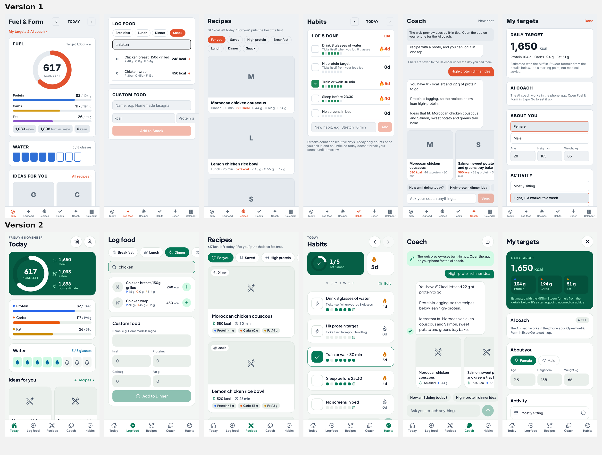
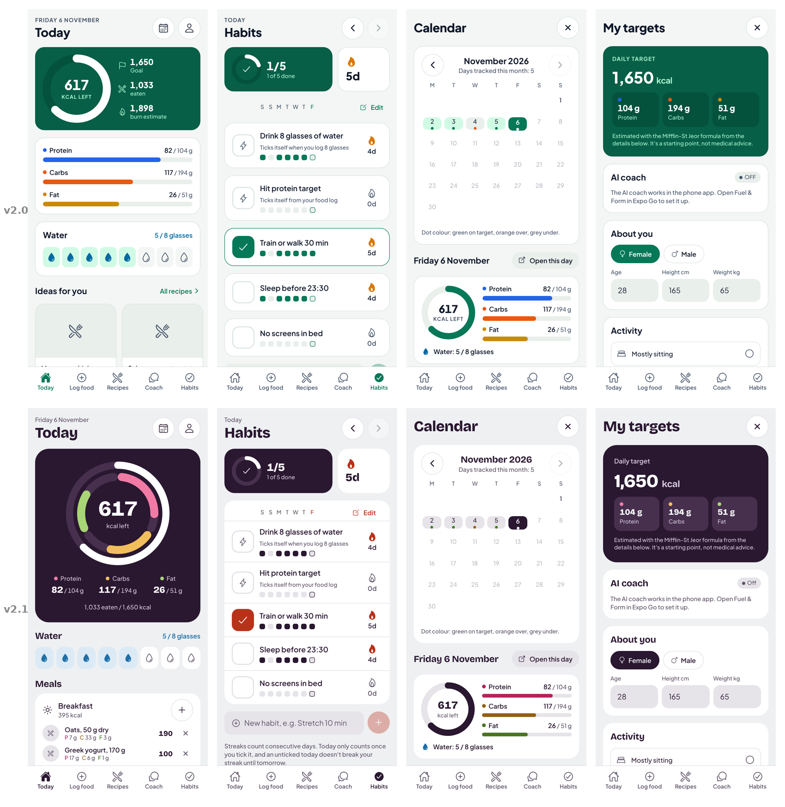

# Fuel & Form — Version 2

A redesign of [Version 1](https://github.com/rowzex/health-app-) using the
[UI/UX Pro Max](https://github.com/nextlevelbuilder/ui-ux-pro-max-skill) design skill.
Same features and data, new look.



Dark mode: [docs/compare-v1-v2-dark.png](docs/compare-v1-v2-dark.png). Every screen in both themes is in [docs/screens](docs/screens).

## Version 2.1: "the plate" (current)

A second pass with four more skills: **frontend-design**, **emil-design-eng**, **vercel-react-native-skills** and **ui-ux-pro-max**. The v2.0 design is kept at the git tag `v2.0`.



Dark mode: [docs/compare-v2.0-v2.1-dark.png](docs/compare-v2.0-v2.1-dark.png).

| Area | v2.0 | v2.1 | Skill |
|---|---|---|---|
| Idea | Generic green fitness kit | The day drawn as a plate: calories fill the rim, protein, carbs and fat fill three inner arcs | frontend-design: one memorable element, rest quiet |
| Colour | Green + blue/orange/yellow macros | Aubergine ink and panel, tomato for actions, macros coloured like food (beet, wheat, olive). All text ≥ 4.5:1 | frontend-design: palette from the subject; ui-ux-pro-max: contrast |
| Type | Plus Jakarta Sans only | Bricolage Grotesque for titles and numbers, Plus Jakarta Sans for reading | frontend-design: type carries personality |
| Labels | All-caps eyebrows, "A · B · C" strings | Sentence case, no middle dots | frontend-design: avoid template tells |
| Layout | A bordered card per meal and per habit | One sheet with rows for meals and for habits; flat surfaces, radius by hierarchy | frontend-design: avoid the card kit |
| Motion | Fade-in on every section, bouncy pops | Only the plate draws in on open; presses scale to 0.97 in 140 ms with a strong ease-out; toasts leave faster than they come; no replaying list staggers; reduced motion respected | emil-design-eng |
| Performance | Bars animated by width, `Animated.Image` | Bars slide with transform only; photos use `expo-image` with memory and disk cache | vercel-react-native-skills |

## Version 2.0: what changed from Version 1

The skill's guidance for a **Calorie & Nutrition Counter** and a **Habit Tracker** drove these choices:

| Area | Version 1 | Version 2 | Skill rule |
|---|---|---|---|
| Colour | Red-orange accent | Healthy green primary, macro colours (protein blue, carbs orange, fat yellow), streak amber, near-black dark mode | Product palette for nutrition apps; OLED dark for fitness |
| Contrast | Not checked | Every text colour ≥ 4.5:1 on its background, in both themes | Accessibility, priority 1 |
| Type | System font, 10–13 px in places | Plus Jakarta Sans, 16 px body, nothing under 12 px | Base 16 px, bold clean sans |
| Icons | Emoji and text symbols (🔥 ✓ ◎ ✦ ▦) | One icon family (Ionicons): outline, filled when selected | No emoji as icons, consistent family |
| Touch | 32–34 px buttons | 48 px minimum, larger hit areas on small links | Touch targets ≥ 44/48 |
| Tabs | 6 tabs | 5 tabs; Calendar and Targets open from buttons on Today | Bottom nav ≤ 5 |
| Forms | Placeholder-only fields | Visible labels on every field, inline error boxes | Labels, errors near the field |
| Layout | Mixed spacing | 4/8 px spacing scale, 20 px card corners, flat cards with no shadows | 8 px rhythm; flat, block-based style |
| Today | Ring + bars in one card | Green hero block with the ring and goal / eaten / burn, macro card, water drops, a card per meal with its own "+" | Block-based layout, progress circle |
| Habits | Checkbox list | Done / total ring, best streak, 7-day dots per habit, bigger checkboxes | Streak + daily check-in patterns |
| Motion | Bouncy springs | Short, consistent timings (150–320 ms), no bounce, respects Reduce Motion | Consistent motion tokens |

Design tokens live in `src/theme.ts`; shared components in `src/components/ui.tsx`.

## About the app

A calorie and habits coach for iOS and Android, built with Expo (React Native) and Expo Router.

- **Today**: animated calorie ring and macro bars, water glasses, recipe ideas that fit what's left, and the day's meals with photos.
- **Log food**: search ~40 common foods (with photos) or add a custom one to Breakfast, Lunch, Dinner or Snack.
- **Recipes**: built-in and saved recipes with photos, ranked for your remaining calories; open one to see ingredients and steps and log it in one tap.
- **Habits**: daily check-offs with streaks and a 7-day history. Water and protein habits tick themselves.
- **Coach**: an AI coach (Claude) that reads your day and answers with recipe cards. It doesn't repeat itself: earlier answers and suggested recipes are sent as context, and the same question on the same day returns the same answer. Without an API key it uses built-in tips that rotate.
- **Calendar** (button on Today): every tracked day with its food, water, habits and coach chats.
- **Targets** (button on Today): calorie and macro targets from age, height, weight, activity and goal (Mifflin-St Jeor), plus the AI coach key.

Data is stored on the device with AsyncStorage.

## Run it

```bash
npm install
npx expo start
```

Scan the QR code with the Expo Go app on your phone, or press `w` for the web preview.

## AI coach

In the phone app, open **Today → the profile button (top right)** and paste a Claude API key from
console.anthropic.com. The key is kept in the phone's secure storage and sent only to the Claude API
(`src/lib/ai.ts`). This suits a personal app; before publishing to the app stores, move the call behind
a small server so users don't need their own key.

Food and recipe photos come from TheMealDB's free API, matched by dish type.

## Languages and accounts

On first launch the app asks for a language (English, French, Arabic or Spanish), then offers a passwordless sign-in: the user enters their email and types the 6-digit code they receive. "Skip for now" lets people try the app first and create an account later in Targets. The AI coach answers in the chosen language. Food and recipe names stay in English for now.

Accounts live in the project's Supabase project (URL and publishable key in `src/lib/auth.ts`; a `.env.local` with `EXPO_PUBLIC_SUPABASE_URL` and `EXPO_PUBLIC_SUPABASE_ANON_KEY` overrides them). For the email to contain the code, the Supabase "Magic Link" and "Confirm signup" email templates must include `{{ .Token }}`.

## Checks

```bash
npm run typecheck
```
